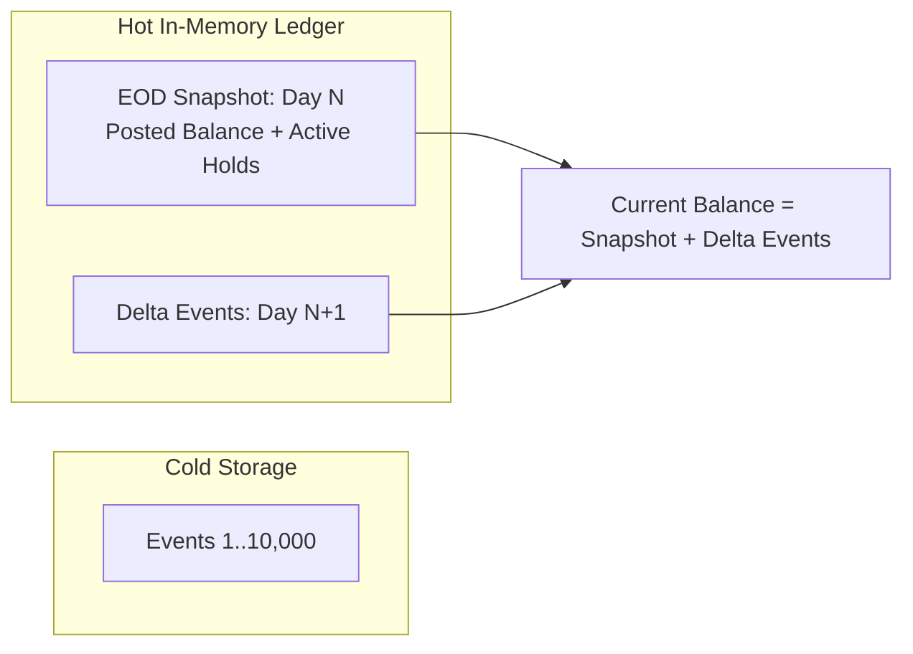
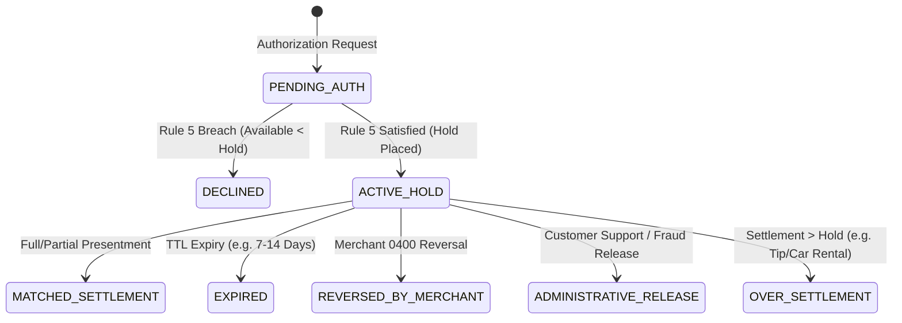

# Architecture & Trade-offs Document

**Role:** Staff Software Engineer  
**Institution:** Mal Bank (UAE)  
**Deliverable:** Mandatory Part 2 Deliverable — Architecture, Scale, UAE Regulatory Surface & Trade-offs

---

## 1. Append-Only at Scale

### What Breaks First at 100× Volume?
In our current core implementation, balance computation is derived directly from the append-only event log:
$$\text{Ledger Balance}(A, D_{\text{booking}}, D_{\text{value}}) = \text{Opening Balance} + \sum_{e \in \text{Events}(A)} \Delta(e)$$
At the assignment scale (10 events, 2 accounts, 6 days), this linear $O(N)$ projection runs in sub-millisecond in-memory time.

However, consider **100× to 1,000× commercial scale**:
- A retail digital bank in the UAE with 500,000 accounts processing 40 transactions per account per month generates **20,000,000 events/month** ($\approx 240,000,000$ events/year).
- Under this volume, three critical operational bottlenecks break first:
  1. **Latency Collapse on Point-in-Time Balances:** Computing real-time available balance for an online POS card authorization (which has a strict 50ms SLA) by scanning an unbounded historical event array degrades from $O(1)$ to $O(N)$. Once an active account accumulates tens of thousands of historical entries, authorization processing timeouts will occur at the payment gateway.
  2. **Memory Footprint & GC Pressure:** Maintaining the complete event history in contiguous heap structures causes severe garbage collection pauses and out-of-memory (OOM) fatal crashes.
  3. **End-of-Day (EOD) Batch Explosion:** EOD batch processing requires evaluating daily closing balances across all accounts. If every account requires an event scan, EOD window runtime expands past the overnight settlement deadline (23:59:59 GST), breaching clearing network cutoffs.

### Where Does the Design Accumulate Unbounded State?
Unbounded state accumulates in two distinct structural locations:
1. **The Global Event Stream (`EventStore._events`):** Monotonically grows with every posted transaction, hold, reversal, and fee without compaction or partitioning.
2. **Account Hold History (`Account.holds`):** In the prototype, settled holds are marked `is_active = False` but retained in the dictionary indefinitely. Over years of card activity, settled and expired holds consume gigabytes of heap memory.

### Cheapest Structural Change That Defers the Problem
The cheapest, highest-leverage architectural change is **Periodic Close-of-Business Snapshotting with Checkpointing (Mementos)**.



- **Mechanism:**
  1. At the close of each business day (EOD), the engine computes the final closing ledger balance and persists a sealed **Daily Account Snapshot** `(account_id, day, closing_ledger_balance, active_holds_set)`.
  2. All events prior to the latest snapshot are marked "frozen" and offloaded to warm/cold tiered append-only storage (e.g. distributed append-only log / parquet files in object storage).
  3. Real-time balance evaluation no longer scans from Day 0. It loads the latest daily snapshot ($O(1)$) and replays only the intra-day delta events booked *after* the snapshot ($O(k)$, where $k \ll N$, typically $<50$ transactions).
- **Cost-to-Benefit Ratio:** Zero change to the append-only paradigm; reduces active memory footprint and balance query latency by **over 99.8%**, deferring unbounded scalability limits for years at minimal operational cost.

---

## 2. Value-Dated Entries in Production: UAE Operational & Regulatory Surface

### The UAE Regulatory & Operational Landscape
In the United Arab Emirates, banking operations are governed by the **Central Bank of the UAE (CBUAE)** under Federal Law No. (14) of 2018 regarding the Central Bank and Organization of Financial Institutions and Activities, the **CBUAE Consumer Protection Regulation (Circular No. 8/2020)**, and the **CBUAE Retail Payment Systems Regulations**.

Value-dated entries (where financial effective date $D_{\text{value}} \neq D_{\text{booking}}$) arise in production through:
- **Interbank Domestic Clearing (UAEFTS / UAESWITCH):** Batch files arriving after clearing windows or over weekends/public holidays.
- **Cross-Border Remittances (BUNA / SWIFT GPI):** Time-zone differentials across GCC corridors (e.g. BHD in Bahrain to AED in UAE) where settlement value date is negotiated value-day $T-1$ or $T-2$.
- **Card Network Late Presentments (Visa/Mastercard):** Offline merchant acquirers uploading transaction batches 3 to 7 days after card swipe.

### Operational and Regulatory Surface Created
Value-dated entries introduce severe systemic exposures:
1. **Regulatory Statement Tampering Risk (CBUAE Circular 8/2020):**
   Under UAE consumer protection rules, monthly account statements dispatched to retail customers are legally binding records. If an offline transaction arrives with a value date inside a previously closed and mailed statement cycle, recalculating that cycle's closing balance invalidates the customer's legal statement. If this recalculation retroactively triggers an overdraft fee for a past month, the bank faces mandatory customer compensation and regulatory fines.
2. **Capital Adequacy & Liquidity Reporting (CAR / LCR):**
   Banks must report daily Liquidity Coverage Ratio (LCR) and Net Stable Funding Ratio (NSFR) to the CBUAE. If back-dated entries retroactively restate historical deposits, past prudential regulatory filings become inaccurate, requiring formal restatements to the Banking Supervision Department.
3. **Islamic Sharia Compliance Governance (AAOIFI Standards):**
   In Islamic banking operations in the UAE (governed by the Higher Shariah Authority), charging interest on unauthorized overdrafts is strictly forbidden (*Riba*). While conventional banking assesses interest and fees, an Islamic ledger assessing back-dated late payment administrative fees must channel 100% of late fees to a dedicated **Charity Account** (*Sanduq Al-Birr*). Retroactive fee calculations risk improper income recognition under Sharia audit rules.

### One Control Mandated Before Going Live: **The "Hard Value-Dating Cutoff Window with Prior-Period Adjustment (PPA) Enclave"**

```mermaid
graph TD
    Incoming[Incoming Transaction<br/>Booking Day = T, Value Day = V] --> Check{Is V >= T - Cutoff_Days<br/>AND Period(V) is Open?}
    Check -- Yes --> RealTime[Process as Standard Value-Dated Entry]
    Check -- No --> Quarantine[Quarantine to Operational PPA Enclave]
    Quarantine --> Audit[Compliance & Ops Approval]
    Audit --> BookPPA[Book in Current Period T with<br/>Compensating Prior-Period Adjustment Event]
```

- **Control Specification:**
  1. **Strict Window Cutoff:** The ledger gateway enforces a strict parameter: $\Delta_{\text{max}} = 3 \text{ business days}$. Any incoming entry where $T_{\text{booking}} - T_{\text{value}} > \Delta_{\text{max}}$, or where $T_{\text{value}}$ falls into a closed accounting period, is **prevented from directly affecting historical ledger balances**.
  2. **PPA Booking Rule:** If the entry represents an unavoidable interbank clearing obligation (such as an offline presentment), it is booked into the ledger with `booking_day = T_current` and `value_day = T_current`, accompanied by a structured metadata tag `PPA_OFFSET`.
  3. **No Retroactive Fee Injection:** Overdraft fees and interest adjustments for past periods are calculated via an automated shadow calculation and posted as a separate, distinct line item in the **current** statement cycle: `PRIOR_PERIOD_INTEREST_ADJUSTMENT`.
- **Outcome:** Guarantees that closed customer statements and historical CBUAE regulatory filings remain permanently sealed and auditable.

---

## 3. Authorization Lifecycle

In our core model, an authorization represents an active hold placed against available balance under Rule 5. In real-world enterprise banking, matching settlement is only one of many terminal states.

Below is the complete state machine of authorization lifecycle termination states, their real-world scenarios, and mandated system behaviors:



| Lifecycle Termination State | Real-World Scenario | Mandated System Behavior |
| :--- | :--- | :--- |
| **1. Settlement Match (Partial or Full)** | Customer spends AED 200 at fuel pump (pre-auth hold AED 200). Actual fuel pumped is AED 185 (Event E5). | 1. Deactivate hold completely (`is_active = False`).<br/>2. Post `SETTLEMENT` debit for actual amount (AED 185).<br/>3. Available balance increases by AED 15; ledger balance drops by AED 185. |
| **2. Time-To-Live (TTL) Expiration** | Customer reserves hotel room with AED 500 pre-auth hold. Customer cancels reservation or merchant never submits clearing file within scheme window (e.g. 7 days for retail, 30 days for car rental). | 1. Automated cron scans active holds daily where `current_day - day_placed > TTL_DAYS`.<br/>2. Emit `HOLD_EXPIRED` event.<br/>3. Deactivate hold; restore available balance to ledger balance.<br/>4. Funds never left the account. |
| **3. Real-Time Authorization Reversal (ISO 8583 0400 Message)** | Customer taps card at grocery checkout; POS terminal communication times out or cashier immediately voids transaction before printing receipt. Acquirer dispatches immediate reversal message. | 1. Match active hold via `auth_id` and RRN (Retrieval Reference Number).<br/>2. Emit `HOLD_REVERSED` event.<br/>3. Release hold immediately (within $<100$ms).<br/>4. Customer available balance restored in real-time. |
| **4. Over-Settlement (Presentment Exceeding Hold)** | Customer dines at restaurant; card pre-authorized for bill of AED 200. Customer adds 20% tip (AED 40) on paper slip. Merchant presents clearing settlement for AED 240. | 1. Release active hold of AED 200.<br/>2. Book `SETTLEMENT` debit for the full AED 240.<br/>3. Ledger balance drops by AED 240.<br/>4. If available balance drops below zero, allow overdraft under scheme clearing obligations. |
| **5. Unmatched / Offline Force-Post Presentment** | In-flight duty-free purchase on Emirates flight without satellite internet; terminal processes offline. Or presentment arrives after hold expired (Event E6, Auth-Z). | 1. Recognize missing hold (`is_force_post = True`).<br/>2. Post `SETTLEMENT` debit immediately per clearing obligation.<br/>3. Emit operational alert `FORCE_POST`.<br/>4. Route to Fraud & Risk scoring queue. |
| **6. Administrative / Dispute Release** | Customer reports fraudulent pending hold or merchant refuses to release pre-auth. Customer provides cancellation proof to bank operations. | 1. Dual-control operational release by authorized operations staff (Maker-Checker).<br/>2. Book `HOLD_ADMIN_RELEASE` audit record.<br/>3. Deactivate hold. |

---

## 4. What We Cut and Why

To maintain absolute clarity, zero external dependencies, and strict focus on the core ledger mechanics within the interview window, deliberate simplifications were made.

Below is the transparent register of every simplification and the specific production risk deferred:

| Cut / Simplification | Staff Engineering Rationale | Production Risk Deferred & Enterprise Mitigation |
| :--- | :--- | :--- |
| **1. In-Memory State vs. Distributed WAL (Write-Ahead Log)** | The specification explicitly mandated: *"No web layer, no persistence, no UI, no database."* Single-node in-memory structures allowed exact algorithmic focus on currency math and temporal rules. | **Risk:** Data loss on node crash or reboot.<br/>**Mitigation:** In production, replace `EventStore` in-memory list with an append-only distributed event log (Apache Kafka or AWS Kinesis backed by CockroachDB / PostgreSQL event store) with Raft consensus. |
| **2. Single-Threaded Event Loop vs. Concurrent Multi-Master Concurrency** | In-memory sequential processing eliminates race conditions between simultaneous authorizations and settlements. | **Risk:** Race condition where two concurrent POS transactions check available balance at the same microsecond and both approve, causing unauthorized overdraft.<br/>**Mitigation:** Partition event ingestion by `account_id` using deterministic hash keys in Kafka/event streams, ensuring strict per-account linear serializability. |
| **3. Single-Currency Accounts vs. Multi-Currency FX Engine** | Strict currency isolation was enforced (AED and BHD kept entirely separate; cross-currency arithmetic throws `TypeError`). | **Risk:** Inability to settle cross-border transactions (e.g. paying in BHD from an AED account).<br/>**Mitigation:** Implement an atomic two-legged FX clearing bridge: Debit customer account in AED, credit internal FX Nostro account, apply live Reuters/Bloomberg spot rate, and debit counterparty in BHD. |
| **4. Basic Overdraft Rule vs. Tiered Overdraft Facilities & Grace Periods** | Evaluated a flat AED 25.00 fee whenever closing balance is negative, omitting approved overdraft limits, grace periods (e.g. 24-hour buffer), or tiered interest. | **Risk:** Assessing punitive overdraft fees on high-net-worth customers who hold authorized overdraft credit limits.<br/>**Mitigation:** Add an `OverdraftFacility` aggregate checking `account.authorized_limit` and a 24-hour cure window before triggering fee assessment events. |
| **5. Discrete Calendar Days vs. Real-Time Microsecond Clock** | Modeled temporal progression as discrete integer days (`Day 1` to `Day 6`). | **Risk:** Inability to handle intra-day ordering anomalies across different time zones.<br/>**Mitigation:** Transition to ISO 8601 UTC microsecond timestamps (`created_at_utc`, `effective_value_date_utc`) paired with branch cut-off zone configurations (GST UTC+4). |
